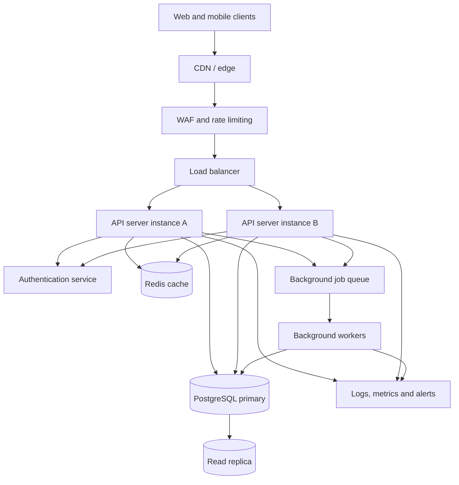

# QuickNotes System Architecture

## 1. Goal and requirements

QuickNotes is moving from a browser-only application to an online service for one million registered users.

### Functional requirements
- Users can securely create accounts and authenticate.
- Users can create, read, update, archive and delete their own notes.
- Users can organize notes into folders and apply tags.
- Users can search and paginate through their notes.
- Notes must remain available across devices.

### Non-functional requirements
- Protect private notes and account credentials.
- Keep common read requests responsive.
- Scale application capacity horizontally.
- Back up persistent data and support recovery.
- Monitor errors, latency and service health.
- Avoid losing acknowledged writes.

## 2. Workload estimates and assumptions

The assignment gives a target of one million registered users but no exact traffic profile. These estimates are explicit planning assumptions, not measured production data.

| Measure | Assumption / calculation | Estimate |
|---|---|---:|
| Registered users | Given target | 1,000,000 |
| Daily active users (DAU) | 10% of registered users | 100,000 |
| Note reads per active user/day | Assumption | 20 |
| Note reads/day | 100,000 × 20 | 2,000,000 |
| Note writes per active user/day | Assumption | 1 |
| Note writes/day | 100,000 × 1 | 100,000 |
| Average read rate | 2,000,000 ÷ 86,400 | ~23 reads/sec |
| Average write rate | 100,000 ÷ 86,400 | ~1.2 writes/sec |
| Peak planning rate | 10× daily average | ~231 reads/sec and ~12 writes/sec |
| Average stored note | Assumption | 2 KB |
| New note data/day | 100,000 × 2 KB | ~200 MB |
| New note data/year | 200 MB × 365 | ~73 GB |

Storage estimate is for note text only. It excludes indexes, database overhead, backups, replicas, attachments and growth in existing notes. Actual traffic will be bursty; the 10× peak factor is a planning assumption to validate with monitoring and load tests.

## 3. High-level architecture

The CDN can serve static frontend assets. Authenticated API traffic passes through security controls and a load balancer to multiple stateless API instances. PostgreSQL is the source of truth; Redis is an optional cache, not the permanent store. A read replica can serve suitable read traffic. A queue and workers handle non-urgent tasks such as exports, cleanup and notification delivery.

## 4. Component explanations

| Component | Responsibility | Why it is included |
|---|---|---|
| Web/mobile clients | Display notes and send API requests | User interface on multiple devices |
| CDN | Cache static frontend assets near users | Reduces latency and origin traffic |
| WAF / rate limiter | Filter suspicious traffic and enforce request limits | Reduces abuse and protects the API |
| Load balancer | Distribute requests across API instances | Supports horizontal scaling and instance health checks |
| API servers | Validate requests, enforce ownership and implement business logic | Keeps application logic separate from clients |
| Authentication | Verify access tokens and user identity | Protects private notes |
| Redis cache | Cache frequently requested data or session-related data | Can reduce repeated database reads |
| PostgreSQL primary | Persist users, notes, folders and tags | Transactional source of truth |
| Read replica | Serve eligible read-only queries | Reduces read pressure on the primary |
| Queue and workers | Process asynchronous jobs | Keeps slow non-critical work out of request paths |
| Monitoring | Collect logs, metrics, traces and alerts | Helps detect and diagnose failures |

## 5. Request flows

### A. Read notes
1. The client sends `GET /v1/notes` with its access token.
2. The WAF/rate limiter checks the request; the load balancer selects a healthy API instance.
3. The API validates the token and derives the user ID from it.
4. The API checks Redis for a suitable cached result. Cache keys must include the user ID and query parameters.
5. On a cache miss, the API queries PostgreSQL (or a replica when replication lag and consistency requirements permit).
6. The API returns the user's notes as JSON and may cache the result briefly.
7. The client renders the response.

### B. Create a note
1. The client sends `POST /v1/notes` with a title, optional body and access token.
2. The API authenticates the user and validates the fields.
3. The API inserts the note into the PostgreSQL primary and commits the transaction.
4. The API invalidates or updates affected cache entries.
5. The API returns `201 Created`, the new note ID and the saved note representation.
6. The client displays the new note.

The API should acknowledge creation only after the database commit succeeds.

### C. Delete a note
1. The client sends `DELETE /v1/notes/{noteId}` with its access token.
2. The API authenticates the user and checks that the note belongs to that user.
3. The API deletes the note in PostgreSQL; related note-tag links are removed by foreign-key cascade.
4. The API invalidates relevant cached note and list data.
5. The API returns `204 No Content`.
6. The client removes the note from the displayed list.

## 6. Scaling strategy

- **Stateless API instances:** run multiple instances behind the load balancer and add capacity based on CPU, memory, request rate and latency.
- **Database indexes:** index owner and update-time fields used by common note-list queries.
- **Caching:** cache short-lived, frequently read data only when measurements show a benefit. Invalidate or update cache entries after writes.
- **Read replicas:** route suitable reads to replicas, while sending writes to the primary. Account for replication lag; immediately read a newly created note from the primary when read-after-write consistency is required.
- **Connection pooling:** limit database connections from the API fleet and reuse connections.
- **Background jobs:** move exports, notifications and cleanup out of synchronous request handling.
- **Pagination:** require bounded page sizes so a request cannot return every note for a large account.
- **Load testing:** test expected and peak rates before launch, then revise estimates using real telemetry.

## 7. Trade-offs and failure handling

| Decision | Benefit | Cost / risk | Mitigation |
|---|---|---|---|
| Redis cache | Faster repeated reads | Stale data and extra infrastructure | Short TTLs, explicit invalidation, database remains source of truth |
| Read replica | More read capacity | Replication lag and extra cost | Use primary for writes and consistency-sensitive reads |
| Multiple API instances | Better capacity and instance resilience | More deployment and monitoring complexity | Health checks, automated deployment and centralized logs |
| Background queue | Faster user-facing requests | Jobs may be delayed or retried | Idempotent workers, retry limits and dead-letter queue |
| PostgreSQL | Strong relationships and transactions | Primary can become a bottleneck | Index/query tuning, pooling, replicas and tested recovery plan |

## 8. Single points of failure

A single PostgreSQL primary is the most important potential single point of failure: if it becomes unavailable, note reads and writes that depend on it may stop. Use automated backups, point-in-time recovery, replication and a tested failover process. A replica is not a substitute for backups.

Other risks include one load balancer, one deployment region, one Redis node, one queue broker or one authentication service. Reduce these risks with managed/high-availability deployments, multiple API instances across failure zones, redundant network entry points, queue durability, monitoring and documented recovery procedures. High availability increases cost and operational complexity, so recovery-time and recovery-point targets should be agreed before selecting the final design.

## 9. Security and observability

- Enforce HTTPS and secure token handling.
- Hash passwords using a modern password-hashing algorithm; never store plaintext passwords.
- Check note ownership on every read, update and delete.
- Validate and limit request sizes; rate-limit authentication and write endpoints.
- Keep secrets out of source control and logs.
- Monitor request rate, p95/p99 latency, error rate, database connections, replica lag, cache hit rate and queue depth.
- Alert on elevated failures, unavailable dependencies and backup/failover problems.
